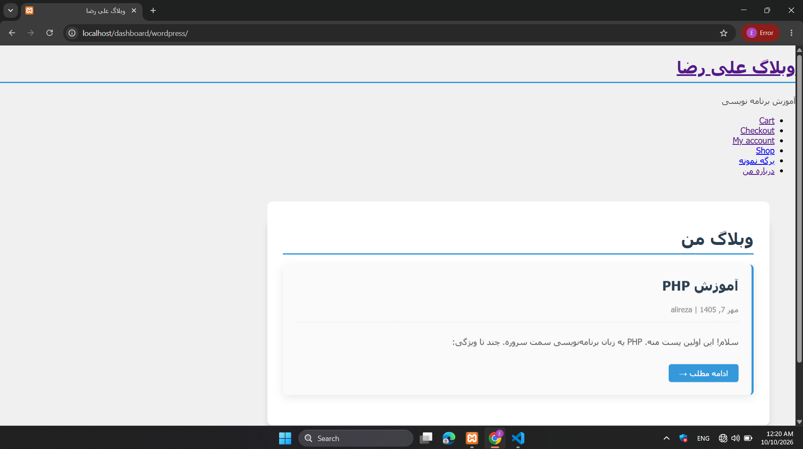
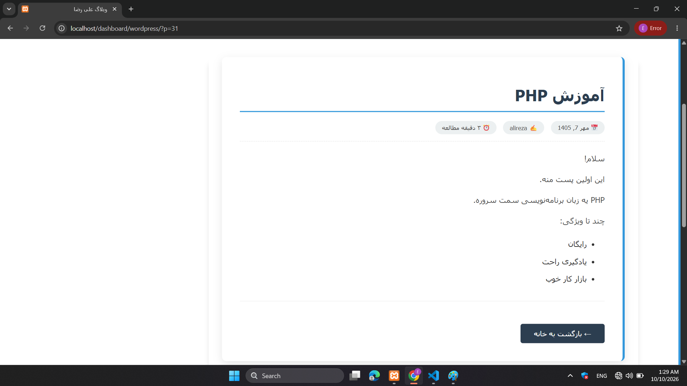
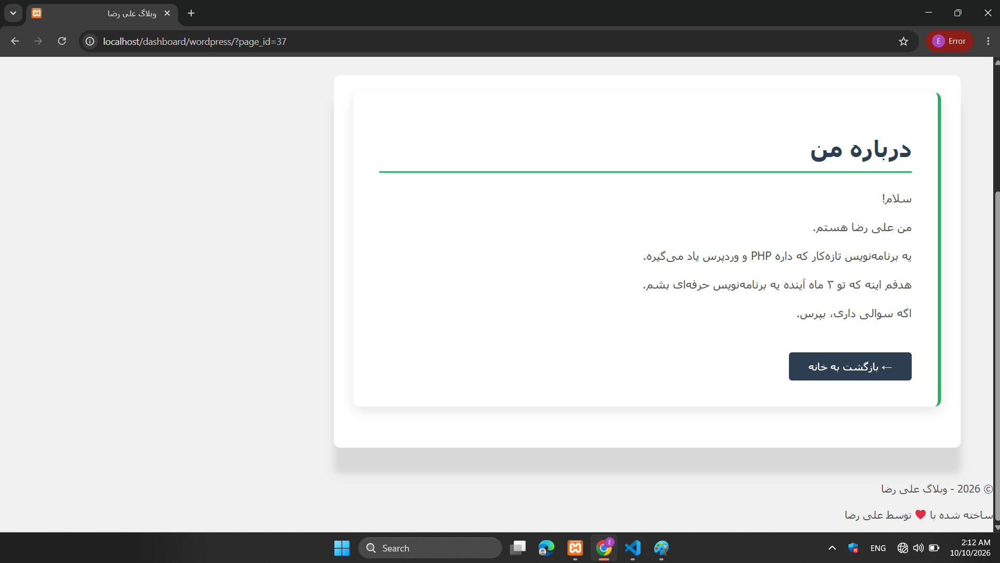

# AliTheme 🌟

A modern, responsive WordPress theme built from scratch with PHP, CSS, and WordPress functions.

---

## ✨ Features

- 📱 Fully Responsive - Works on all devices
- 🌐 RTL Support - Perfect for Persian/Arabic
- ⚡ Fast Loading - Optimized performance
- 🎨 Modern Design - Clean and beautiful
- 📝 Custom Post Meta - Reading time, author, date
- 📤 Social Sharing - Twitter, Telegram, WhatsApp
- 🔗 Post Navigation - Previous/Next posts
- 🎯 Custom Menu - Easy navigation
- 🌙 Dynamic Greeting - Time-based welcome message

---

## 📸 Screenshots

### Homepage

### Single Post

### Page

---

## 🛠 Tech Stack

- Backend: PHP 7.4+
- Frontend: HTML5, CSS3
- CMS: WordPress 5.0+
- Standards: WordPress Coding Standards

---

## 📁 File Structure

my-theme/
├── style.css
├── index.php
├── header.php
├── footer.php
├── single.php
├── page.php
├── functions.php
├── readme.txt
└── screenshots/
    ├── home.png
    ├── single.png
    └── page.png

---

## 🚀 Installation

1. Download the theme
2. Upload to /wp-content/themes/
3. Activate from WordPress admin
4. Create a menu and assign to "Primary" location

---

## 📋 Requirements

- WordPress 5.0 or higher
- PHP 7.4 or higher
- MySQL 5.6 or higher

---

## 🎯 What I Learned

This theme was built from scratch to learn:
- WordPress theme development
- PHP templating
- WordPress The Loop
- Custom post meta
- RTL design
- WordPress hooks & filters

---

## 📬 Contact

- GitHub: [@alidev-php](https://github.com/alidev-php)
- Email: alishahabi6780@gmail.com

---

## 📄 License

This project is licensed under the GPL v2 or later.

---

⭐ If you like this theme, give it a star!